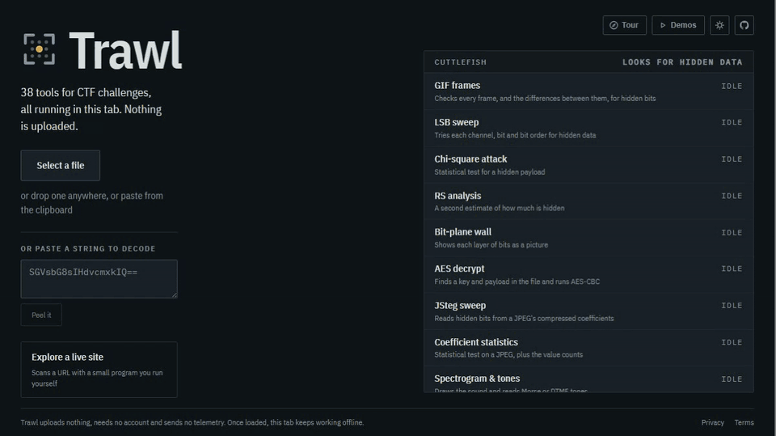

# Trawl

Drop in a file or paste a string, and Trawl looks for whatever is hidden in it. It runs in your
browser, so nothing gets uploaded.



**[Try it at trawlctf.vercel.app](https://trawlctf.vercel.app)**. There's nothing to install and no account.

It is built for capture-the-flag competitions, where a puzzle often arrives as
an ordinary-looking image, a sound file or a line of text with a message buried
inside it. [ROADMAP.md](ROADMAP.md) has the current state.

## What it is for

A competition hands you a photo with a password hidden in it. The password isn't
written on the picture. It's written into the numbers the picture is made of, so
looking at the image tells you nothing.

The usual answer is four or five separate programs, in three languages, one of
them an abandoned Java applet from 2011. For someone who has done it before, that
is fifteen minutes of habit. For a beginner it is the reason they skip the
category. Trawl runs the same checks from one page and tells you which one found
something.

## What it can do

Drop in a file and everything that applies runs at once. Trawl reads what the file
says about itself: hidden text, camera metadata, other files buried inside it, and
anything stuck on the end where a viewer would never look. You can save a buried
file with one click. Files inside a ZIP, or carved out of the middle of another
file, get the same checks automatically, a few levels deep.

Cuttlefish, the steganography half, goes after the data itself. It shows every bit
layer of an image at once so an odd one stands out, and tries up to 84 ways of
reading hidden bits so you don't have to guess which. Two published statistical
tests estimate how much of a file carries a payload. Sound files get the same
bit-level treatment plus a spectrogram, since a picture drawn into audio only shows
up when you look at the sound, and Morse and DTMF tones get decoded. JPEGs get
their compressed numbers read directly, because that is where JPEG payloads live.
Images with a palette get the choices between duplicate colours read back. Animated
GIFs are read frame by frame, along with the difference between each pair of frames.

Some files hide things in their structure, so Trawl reads these formats the way
their own software does and then looks at what that software skips:

- ZIP archives are read twice, through the headers and through the directory, and
  any disagreement is reported. Each entry is unpacked and scanned where it sits.
- PDFs are searched for every object, then compared with the cross-reference table,
  which shows up leftovers from an earlier revision. Compressed streams get inflated
  and scanned.
- ELF and PE binaries are read for their sections, imports and the protections they
  declare. Trawl doesn't disassemble anything.
- Windows registry hives are walked for the USB devices they remember and when each
  key was last written.
- SQLite databases are read for their tables and rows, including deleted rows still
  sitting in the file's free space.
- Packet captures, pcap and pcapng, are read for protocols, conversations and DNS
  questions, and their TCP streams are rebuilt so a flag split across packets reads
  again.

Paste a string instead and Mantis, the cryptography half, takes over. It works out
what the string has been through and undoes it layer by layer: base64 around hex
around a rotation, unwound until something readable comes out, inflating gzip or
zlib along the way. If what's underneath is encrypted, it attacks it with XOR,
Caesar, Vigenère, affine, 2x2 Hill, rail fence, columnar transposition and simple
substitution, each recovering its own key without asking you for one. It also names
hash formats, reads Bacon and Polybius, runs Brainfuck and goes after badly built
RSA keys. When nothing fires it lays out every rotation it knows with the promising
ones first, so you can finish by eye, and you can type in a key if you already have
one. Mantis won't guess: an answer that is a token reads like nothing to a scorer,
and saying so beats picking one at random and sounding sure.

A link is the third kind of input. Remora, the web-exploration half, is for a
challenge that lives on a site. A browser tab can't reach a site it wasn't served
from, so Remora runs as a small program you start on your own machine with one line
the page gives you. It follows links, scripts, robots and the sitemap to pages
nothing advertises, tries a short list of places a file gets left by mistake, and
reads each page for a flag, whether it's in plain sight or hidden in a cookie or a
variable. Any image it finds can be opened against Cuttlefish in a new tab. A second
mode, off until you confirm you're allowed to test the target, sends what a page
didn't ask for and forges a JSON web token when the site leaks its signing key or
uses a weak one.

Everything found collects in the Cod-end, the panel at the top of the page, along
with the route each flag was reached by. The header holds the list of flag shapes
to match (`flag{`, `CTF{`, `key{` and a few more, and you can add your own) and a
button that hands the whole analysis back as a Markdown writeup.

## What it will not tell you

Trawl never tells you a flag is the answer. Everything in the Cod-end matched on
shape, and when a result is uncertain Trawl says what it measured and lets you
decide.

Every detector is tested against files with a known answer, and against clean files
too, so it stays quiet when there is nothing there. A tool that reports something
on every file is no better than one that reports nothing.

It does tell you where it stopped. A file can ask for more than a browser tab can
give, so decompression, nesting and the flag list all have limits, and a file that
reaches one gets a note on the page and in the writeup saying what went unread. The
LSB sweeps read the first 4 KB of each combination, so a message that starts further
in won't show up in a sweep.

## Why not just upload it to an AI

Because the model never receives your file. Before the network sees an image, the
image is decoded, shrunk and turned into averages, and a blend of two numbers
doesn't keep the last digit of either. The hidden message is in those last digits,
so it is gone before the model starts reading. The answer you get back is either an
honest "I can't see that" or a confident invented one, and under a competition clock
the second one costs you real time.

An assistant that can run code is a different case. It can read the bytes, but what
it writes is a fresh, untested program every time, and a program that finds nothing
because it has a bug looks exactly like a file with nothing in it.

## Everything runs on your machine

Trawl has no server, no upload, no account and no tracking. Once the page has loaded
it keeps working with the network unplugged, and your file is opened read-only. That
also settles a rules question: most competitions forbid passing challenge files to
outside services, and Trawl has nowhere to send yours.

Web exploration is the one part that touches the network, because reaching a site is
the whole job. Remora still runs on your own machine and talks only to the target you named, any
site that target redirects it to, and your own browser. A redirect to another site is read like any page and noted in the results, and Remora
won't guess file names there. The active checks run only if the target stays at the
address you named.

## How it works

The analysis is written in Rust and compiled to WebAssembly, running in a background
thread so the page stays responsive. Some of these checks are hundreds of millions of
small calculations, so speed matters.

Almost nothing is borrowed. `package.json` lists no runtime dependencies, and the
Rust core's only dependency is `wasm-bindgen`, the bridge to JavaScript. Every parser,
detector and attack was written for this project, including the PNG, BMP, GIF, WAV and JPEG decoders, the inflate that opens a file's
compressed streams, and the Fourier transform behind the spectrogram. Only gzip and
zlib in pasted text go through the browser's own decompressor.

One thing worth knowing: the browser's own image decoder can't be trusted here. Ask a
canvas for pixel values on an image with any transparency and it alters the lowest
bit of a fifth of them, through the arithmetic it uses to store transparent colour.
That bit is the data being looked for. No setting turns it off, so Trawl decodes
images itself, and the test suite measures both paths.

## Running it locally

You need Rust with the `wasm32-unknown-unknown` target, `wasm-pack`, Node 20 or newer,
and Python 3.

```bash
git clone https://github.com/Yuv1s/Trawl
cd Trawl
python serve.py
```

`serve.py` installs the npm packages if they are missing or out of date, builds
Trawl if the source has changed, serves the result at <http://localhost:8000> and
opens it in your browser.

For hot reloading while you work on the interface:

```bash
npm install
npm run build:wasm
npm run dev
```

Tests:

```bash
npm test                              # the interface
cd trawl-core && cargo test --release # the analysis core
cd trawl-scan && cargo test           # the web scanner
```

Test files are built from scratch by `fixtures/generate.mjs`, so you can reproduce
every result the tests claim. A labelled [sample library](static/samples/README.md)
covers the common tools, with clean PNG, JPEG and WAV controls beside the planted
samples.

The scanner behind Remora is a separate crate in `trawl-scan`, kept apart from the
offline core because it is the one part that reaches the network. The Web exploration
page shows the exact command to run it from a clone.

## The names

Trawling is dragging a net through water and sorting whatever comes up, which is
close to what this program does with a dropped file.

**Cuttlefish**, the steganography half. Cuttlefish hide by rewriting their own
surface, which is what hiding a message in an image does to the picture. Their ink
is also where the colour sepia comes from.

**Mantis**, the cryptography half. The mantis shrimp cracks armoured shells with the
fastest strike in the animal kingdom, and sees a range of colour we are blind to.
Force and perception, which is the whole of code breaking.

**Remora**, the web-exploration half. A remora attaches to a larger host and rides
it, going everywhere the host goes. This one attaches to a live site and brings back
every part of it for the other tools to read.

**Cod-end** is the closed end of a trawl net, where the catch collects. In the app it
is the panel holding everything the tools brought up.

## Licence

[MIT](LICENCE.md).
